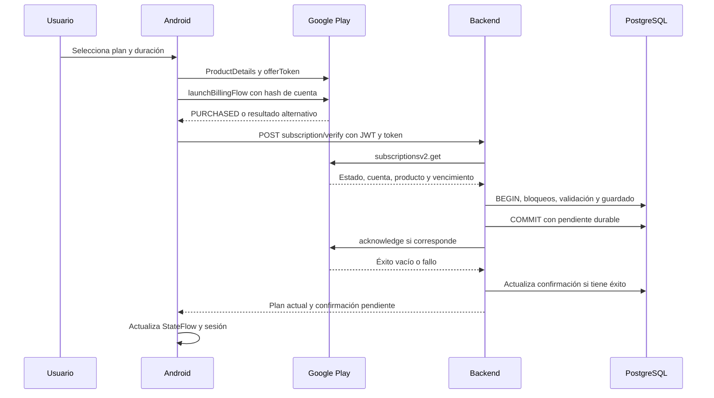
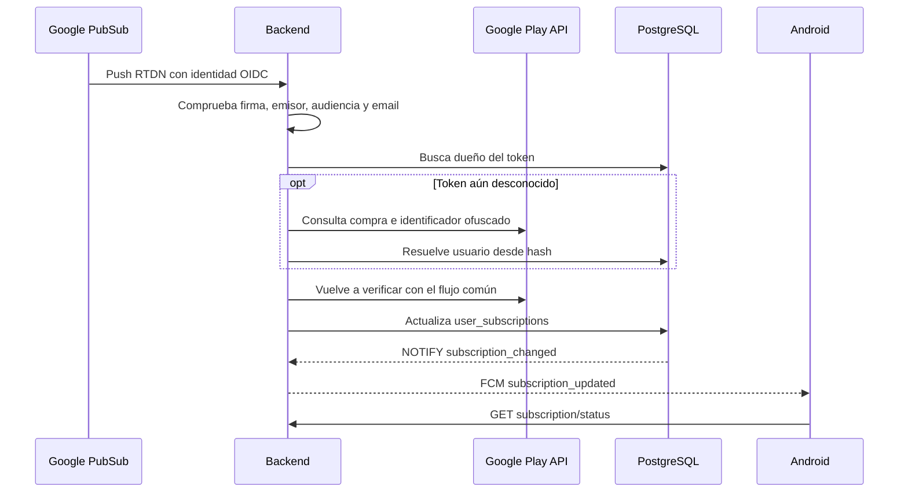

# Pagos y suscripciones: Android, Google Play y backend

Revisión del código local: 2026-10-23. Documento de mantenimiento del flujo actual, sus cambios y sus límites. La inspección de código no acredita una compra real ni un despliegue funcionando. El checkout Android se consultó en modo lectura; esta entrega de documentación solo modifica este repositorio.

## 1. Regla de negocio y responsabilidades

Cada usuario tiene un único plan: Free, Plus o Premium. Una fila de `user_subscriptions` representa su suscripción actual. Premium incluye los permisos Plus: `isPremium=true` e `isPlus=true` expresan herencia de permisos, no dos compras simultáneas. Si vence el acceso del plan actual, el usuario pasa a Free. No se busca una compra Plus anterior para restaurarla automáticamente.

| Componente | Responsabilidad |
| --- | --- |
| Android | Mostrar ofertas, abrir Play, recibir compras, enviar tokens al servidor, restaurar y representar el estado recibido |
| Google Play | Cobrar, renovar y mantener el estado y vencimiento oficiales de la compra |
| Backend | Consultar Google, comprobar cuenta y tokens, guardar la suscripción, confirmar el procesamiento y autorizar funciones |
| PostgreSQL | Conservar el único plan, estados operativos y propiedad histórica de tokens |
| RTDN y worker | Actualizar el estado aunque el usuario no abra la pantalla de pagos |
| FCM | Avisar a Android de que debe volver a consultar su estado; no conceder acceso por el contenido de una notificación |

El resultado de abrir la ventana de Play no prueba que se haya pagado. Un pago aceptado por Play tampoco sustituye la validación del servidor. `acknowledge` confirma a Google que se procesó la compra: no es un cobro adicional y no equivale a la validación de propiedad.

## 2. Archivos que conectan el flujo

Backend:

- [play-billing.js](../src/services/play-billing.js): consulta Google, validación, transacciones, sustituciones, confirmación, reconciliación y webhook.
- [subscription.controller.js](../src/controllers/subscription.controller.js): status, verify y cancel-intent.
- [subscription.dto.js](../src/dto/subscription.dto.js): lista blanca pública y cálculo de permisos por vigencia.
- [subscription.routes.js](../src/routes/subscription.routes.js) y [subscription.schemas.js](../src/validation/subscription.schemas.js): guardas y validación de peticiones.
- [auth.middleware.js](../src/middleware/auth.middleware.js): permiso del usuario y cabecera de plan en respuestas autenticadas.
- [subscriptionListener.js](../src/services/subscriptionListener.js), [notificationService.js](../src/services/notificationService.js) y [trigger 013](../src/database/migrations/013_user_subscriptions_notify.sql): cambios de base a notificación FCM.
- [worker](../scripts/affinity-worker.js) y [temporizador](../deploy/systemd/mirailink-affinity-billing.timer): ejecución periódica.
- [migración 021](../src/database/migrations/021_subscription_confirmation.sql): ampliación de la tabla actual.

Android, rutas relativas al repositorio hermano `../MiraiLink` desde la raíz del backend:

| Archivo bajo app/src/main/java/com/feryaeljustice/mirailink | Función |
| --- | --- |
| data/billing/BillingClientManager.kt | Conexión Play, consulta de productos, apertura de pago y consulta de compras |
| data/repository/SubscriptionRepositoryImpl.kt | Verificación remota, restauración, recuperación automática y estado reactivo |
| data/remote/SubscriptionApiService.kt | Retrofit para las tres operaciones autenticadas |
| data/model/response/subscription/SubscriptionStatusDto.kt | Campos que consume actualmente Android |
| ui/screens/subscription/SubscriptionPaywallViewModel.kt | Selección de plan y duración, compra y restauración |
| ui/screens/subscription/SubscriptionManageViewModel.kt | Consulta del estado e intención de cancelación |
| ui/screens/subscription/SubscriptionManageScreen.kt | Apertura del enlace de gestión |
| data/remote/interceptor/AuthInterceptor.kt | JWT y sincronización de permisos desde X-Subscription-Plan |
| service/FcmService.kt | Recepción de subscription_updated y consulta del estado |
| di/koin/SerializationModule.kt | JSON con ignoreUnknownKeys=true |

## 3. Productos, ofertas y precio

Los productos admitidos son `mirailink_plus` y `mirailink_premium`, para el paquete `com.feryaeljustice.mirailink`. Android consulta `ProductDetails` de tipo SUBS y busca un offerToken del basePlanId seleccionado. Constantes actuales: weekly-autorenew, monthly-autorenew, three-month-autorenew y el alias histórico threee-month-autorenew.

La pantalla ofrece plan y duración. El repositorio transforma las ofertas de Play en opciones y precios formateados. También contiene precios de presentación de respaldo: no constituyen una consulta actual a Play ni garantizan el precio final. La apertura de pago requiere ProductDetails y un offerToken real para el plan solicitado; el cobro efectivo lo muestra y ejecuta Google.

Aunque Android envíe basePlanId y orderId, el backend obtiene los valores persistidos desde Google. No calcula el vencimiento sumando 7, 30 o 90 días a la petición. El contrato conserva esos campos de entrada por compatibilidad.

## 4. Compra nueva: recorrido completo



1. BillingClientManager conecta con Play y consulta productos.
2. Al comprar, exige un usuario de la app. Calcula SHA-256 de su identificador y lo envía como obfuscatedAccountId. No envía el UUID en claro a través de ese campo.
3. Un resultado OK de launchBillingFlow indica que se abrió el flujo. La compra llega después por onPurchasesUpdated.
4. handlePurchase solo emite PurchaseSuccess para PURCHASED. PENDING no concede éxito ni error en ese punto.
5. SubscriptionRepositoryImpl recibe el evento y envía purchaseToken, productId, basePlanId y orderId al backend. Solo retransmite PurchaseSuccess a la pantalla si la verificación remota tiene éxito. Un error produce VerificationFailed.
6. La respuesta de verificación actualiza subscriptionInfo y los permisos de la sesión. El paywall observa ese estado; no se concede Premium por pulsar comprar.

## 5. Qué comprueba y guarda el backend

verifyAndSavePurchase obtiene acceso OAuth con la cuenta de servicio, consulta subscriptionsv2 y analiza sus lineItems. Su caché OAuth evita generar un token en cada petición mientras siga vigente. El transporte tiene timeout de 15 segundos por petición a Google.

Dentro de una transacción:

1. Bloquea la cuenta antes de consultar Google, serializando verificaciones de ese usuario.
2. Comprueba producto admitido, producto esperado y vencimiento; un pago pendiente puede carecer de vencimiento y no obtiene acceso.
3. Bloquea los tokens actual y enlazado en orden estable para evitar carreras de propiedad.
4. Rechaza tokens de otro usuario. Para una vinculación nueva exige que el identificador ofuscado de Google coincida con SHA-256 del usuario autenticado. Un token ya conocido puede usar su propiedad persistida si Google no incluye el identificador.
5. Si el token ya está sustituido, conserva la suscripción actual. Consultar un token viejo no restaura el plan anterior.
6. Valida propiedad y coherencia del linkedPurchaseToken, si existe, y rechaza un token enlazado consigo mismo.
7. Protege el único plan ante sustituciones no confirmadas; ver sección de cambios de plan.
8. Registra propiedad y sustituciones en play_purchase_owners y actualiza la única fila de user_subscriptions mediante ON CONFLICT(user_id).
9. Guarda el pendiente de confirmación antes del COMMIT. Después libera la conexión transaccional.

Las respuestas públicas pasan por subscriptionDto. No devuelven purchaseToken, revision, credenciales, fila cruda ni errores internos de Google. El servidor decide los permisos mediante datos persistidos y vigencia, no por los precios ni por los booleanos enviados por el cliente.

## 6. Confirmación y reintentos

Una compra con acceso y ACKNOWLEDGEMENT_STATE_PENDING requiere acknowledge. Se intenta después del COMMIT. HTTP 200 vacío y 204 se aceptan sin intentar leer JSON. Las operaciones que sí requieren JSON siguen rechazando una respuesta vacía o inválida.

Si acknowledge falla, la compra sigue guardada y verify devuelve HTTP 200 con acknowledgementPending=true. El fallo no provoca ROLLBACK de una transacción ya confirmada. Si falla incluso la escritura del código del error, el pendiente ya estaba guardado antes de llamar a Google.

Cada escritura de verificación cambia revision. El resultado de acknowledge solo limpia el pendiente si coinciden token y revisión, evitando que una respuesta antigua sobrescriba una verificación posterior. Cambiar a un nuevo token reinicia sus contadores y limpia la intención del plan anterior.

Los intentos se planifican en la base, sin sleeps del proceso: 1, 2, 4 y hasta 6 horas. Una nueva verificación respeta esa fecha; no implica necesariamente un acknowledge inmediato. Si Google ya informa ACKNOWLEDGED, la verificación limpia el pendiente sin repetir esa operación. Un proceso reiniciado puede continuar con los campos guardados.

acknowledgementPending no significa pago pendiente. Es posible tener acceso ya validado y confirmación pendiente. Un pago PENDING no obtiene acceso por este mecanismo.

## 7. Un único plan y cambios de plan

| Situación | Comportamiento del backend |
| --- | --- |
| Mismo token | Actualiza la misma suscripción con la información actual de Google |
| Otro token con plan vigente y sin linkedPurchaseToken hacia el actual | HTTP 409 PURCHASE_REPLACEMENT_REQUIRED |
| Sustitución confirmada por Google | Actualiza la fila y marca el token anterior como sustituido |
| Nueva compra aceptada después del vencimiento anterior | Reemplaza la fila y bloquea la restauración del token anterior |
| Reemplazo pendiente mientras existe otra fila | Rechaza la sustitución y preserva la fila anterior |
| Vence Premium | Acceso Free; no restaura Plus |
| Token antiguo vuelve por app o RTDN | No vuelve a otorgar su plan |

**Límite actual de Android:** launchBillingFlow construye producto, oferta e identificador ofuscado, pero no configura SubscriptionUpdateParams ni el token anterior. Por tanto, no hay evidencia en ese método de un flujo explícito de upgrade/downgrade Play. El backend protege el modelo único; esa protección no implementa por sí sola el cambio de plan en Android. No se debe presentar la compra independiente de otro producto como un cambio ya soportado.

El backend rechaza una compra incompatible después de que Play pueda haberla cobrado. Este rechazo no cancela ni reembolsa automáticamente el cobro. Antes de considerar listo el cambio de plan para usuarios reales, hay que implementar y probar el flujo de sustitución del cliente. PURCHASE_REPLACEMENT_REQUIRED tampoco tiene un mapeo específico encontrado en NetworkErrorMapper: se trata por la vía general del conflicto HTTP 409.

## 8. Estado del proveedor, acceso y renovación

| Estado Google | Acceso actual |
| --- | --- |
| ACTIVE | Sí, si queda vigencia |
| IN_GRACE_PERIOD | Sí, según vencimiento comunicado |
| CANCELED | Sí, hasta el fin del periodo pagado |
| ON_HOLD | No |
| PAUSED | No |
| EXPIRED | No |
| PENDING / PENDING_PURCHASE_CANCELED | No |

providerState conserva el estado original SUBSCRIPTION_STATE_*. status conserva una representación compatible: active o expired; sin fila es free. plan indica permisos actuales: free, plus o premium. Un registro histórico puede permanecer en la base con productId de Premium y plan=free porque su acceso venció.

hasAccess exige verificación de proveedor, status activo, producto admitido y vencimiento futuro. isPremium exige además el producto Premium. isPlus=true para Plus o Premium con acceso. autoRenewing describe lo informado por Google, no una intención local.

## 9. Restauración y recuperación en Android

Restaurar consulta compras SUBS y filtra PURCHASED de los dos productos admitidos. Cada token se vuelve a enviar al backend para verificarlo. Un Mutex evita dos restauraciones simultáneas en el repositorio. Si no hay compras válidas, consulta status; si alguna verificación falla, devuelve ese error aunque otra hubiera tenido éxito.

El repositorio actual también recupera automáticamente cuando hay conexión Billing, usuario autenticado y modo real. Reintenta cada minuto si restorePurchases falla y cada hora si tiene éxito. collectLatest cancela ese ciclo cuando cambia la cuenta o su elegibilidad. Los tokens se recuperan de Play, sin persistencia local nueva de tokens por este mecanismo.

Límites: queryActivePurchases devuelve una lista vacía tanto si no hay compras como si Billing no está listo o falla. Restaurar no distingue esas situaciones mediante esa lista; puede terminar consultando status sin haber restaurado realmente Play. No se ha validado la ausencia de carreras de sesión en cada petición ya en curso al cambiar de usuario.

## 10. RTDN: cambios sin abrir la app



El webhook es POST /api/subscription/google-play-notifications. No usa la sesión JWT de un usuario: comprueba el JWT OIDC de Google, clave pública por kid, algoritmo RS256, emisor permitido, audiencia, email configurado y email_verified=true. Comprueba también el paquete de la notificación. El número de tipo de RTDN no se usa como autoridad para conceder acceso: se vuelve a consultar Google.

En el código actual existe recuperación de un token aún no vinculado: consulta Google, valida un identificador ofuscado hexadecimal de 64 caracteres y busca un usuario no eliminado cuyo UUID produzca ese hash. Después reutiliza verifyAndSavePurchase. Así puede recuperar una compra si la app se cerró antes de entregar el token. Se documenta como comportamiento presente en el checkout; no se atribuye todo ese código a esta intervención.

Un mensaje procesado devuelve 204. Si no se puede resolver la cuenta, devuelve error en lugar de descartar silenciosamente el token. La recuperación sigue dependiendo de tener el webhook, Pub/Sub y credenciales configurados y funcionando. El documento no acredita esa configuración desplegada.

## 11. Worker y sincronización de permisos

El modo billing de scripts/affinity-worker.js ejecuta reconcileSubscriptions. Procesa hasta 100 filas por lote: hasta 50 confirmaciones pendientes elegibles y hasta 50 verificaciones ordinarias restantes. Excluye tokens sustituidos. Reconsulta Google y usa el mismo servicio de persistencia.

INVALID_PURCHASE invalida solo el token que siga correspondiendo a una verificación vencida. Un fallo transitorio aplaza su próxima verificación una hora. Continúa el lote ante indisponibilidad del proveedor y al final comunica PLAY_UNAVAILABLE. Los errores de otros tipos pueden interrumpir el lote. No garantiza vaciar un atraso arbitrariamente grande en una sola ejecución.

El temporizador existente inicia tras dos minutos y tiene OnUnitInactiveSec=1h. Persistent=true está configurado, pero la comprobación de entrega no acreditó que el temporizador esté habilitado en el servidor. Los reintentos automáticos requieren ejecutar el worker; los archivos de despliegue no lo arrancan por sí solos.

Un trigger de user_subscriptions emite subscription_changed. subscriptionListener escucha y solicita FCM subscription_updated; el servicio agrupa avisos repetidos del mismo usuario dentro de cinco segundos. Android recibe ese tipo y consulta status. Un fallo de FCM no cancela la escritura de suscripción. FCM requiere configuración y token de dispositivo.

AuthInterceptor añade el JWT y lee X-Subscription-Plan para actualizar permisos de la sesión vigente. No equivale a refrescar todos los detalles de subscriptionInfo. Las rutas status y verify corrigen esa cabecera con el plan que devuelven. El backend sigue comprobando autorización, aunque la UI tenga un estado desactualizado.

## 12. Cancelación

1. La pantalla llama al caso de uso de intención de cancelación.
2. POST cancel-intent registra cancellation_intent_at en user_subscriptions.
3. Devuelve el enlace Google Play con paquete y SKU actual; si no hay fila, usa el SKU Premium como respaldo.
4. Android abre el enlace. El usuario debe completar la gestión dentro de Google Play.
5. RTDN o una consulta posterior actualizan la renovación y el estado real.

Pulsar el botón no cancela la facturación. Si el usuario sale de Play sin cancelar, autoRenewing no se falsifica. En la pantalla inspeccionada no se encontró un refresco automático específico de ON_RESUME al volver de ese enlace; existen el refresco del ViewModel, RTDN/FCM y la recuperación del repositorio, con sus límites de entrega.

## 13. Contrato HTTP resumido

Las tres operaciones de usuario requieren Bearer JWT. verify y cancel-intent validan el body con Zod.

| Método y ruta | Entrada y salida |
| --- | --- |
| GET /api/subscription/status | Devuelve plan y estado persistidos con acceso calculado por vigencia |
| POST /api/subscription/verify | purchaseToken y productId obligatorios; basePlanId y orderId compatibles. Devuelve el único plan actual |
| POST /api/subscription/cancel-intent | reason opcional. Devuelve message y playStoreUrl |
| POST /api/subscription/google-play-notifications | Sobre Pub/Sub autenticado con OIDC. 204 al procesar |

Ejemplo ilustrativo de verify/status, sin tokens ni datos reales:

```json
{
  "isPremium": true,
  "isPlus": true,
  "plan": "premium",
  "status": "active",
  "productId": "mirailink_premium",
  "basePlanId": "monthly-autorenew",
  "expiresAt": "2030-01-01T00:00:00.000Z",
  "autoRenewing": true,
  "providerState": "SUBSCRIPTION_STATE_ACTIVE",
  "hasAccess": true,
  "acknowledgementPending": true
}
```

Android consume actualmente los ocho campos originales de SubscriptionStatusDto; no incorpora providerState, hasAccess ni acknowledgementPending en su modelo de dominio. Su serializador permite campos desconocidos, por lo que no rompe por esos campos aditivos, pero tampoco los muestra como estados específicos. No hay verifiedPurchase adicional.

| Error | Lectura operativa |
| --- | --- |
| PLAY_NOT_CONFIGURED / 503 | Falta configuración requerida de Google |
| PLAY_UNAVAILABLE / 503 | Fallo de transporte, proveedor o JSON requerido inválido durante la consulta |
| INVALID_PURCHASE / 403 | Compra incompatible/inválida según comprobaciones o respuesta 400/404 de Google |
| PURCHASE_ACCOUNT_MISMATCH / 403 | No coincide o no se puede resolver la cuenta |
| PURCHASE_ALREADY_BOUND / 403 | Token de otra cuenta |
| PURCHASE_REPLACEMENT_REQUIRED / 409 | Otra compra no puede sustituir el plan actual en esas condiciones |
| INVALID_NOTIFICATION / 401 o 400 | Identidad o paquete de notificación inválidos |

No todos los errores de archivos de credenciales, datos malformados o base se convierten específicamente en PLAY_UNAVAILABLE; el middleware general puede responder con error interno normalizado. Los códigos anteriores describen los caminos explícitos del servicio.

## 14. Persistencia y migración

user_subscriptions conserva id, user_id único, product_id, base_plan_id, purchase_token, order_id, status, auto_renewing, start_date, expires_at, last_verified_at, created_at, updated_at, provider_verified y provider_state. start_date se conserva en un cambio de token con el UPSERT actual: no representa necesariamente el comienzo de la última compra.

Campos añadidos por 021:

| Campo | Función |
| --- | --- |
| cancellation_intent_at | Momento de intención local, independiente de Google |
| revision | Revisión UUID para no sobrescribir verificaciones nuevas con confirmaciones antiguas |
| acknowledgement_pending | Google sigue pendiente de confirmación |
| acknowledgement_attempts | Intentos planificados/realizados; no un contador de cobros |
| acknowledgement_next_attempt_at | Fecha mínima del siguiente intento |
| acknowledgement_error_code | Código operativo sanitizado |
| verification_next_attempt_at | Fecha de elegibilidad para reconciliación |

La migración añade unicidad de purchase_token e índices de verificación y confirmación. Usa IF NOT EXISTS para columnas e índices. Se probó con cancellation_intent_at ya existente y dos ejecuciones seguidas conservando datos. IF NOT EXISTS no comprueba que una columna preexistente tenga el tipo esperado ni corrige índices distintos con el mismo nombre.

play_purchase_owners ya existía: conserva token único, user_id, creación y superseded_by. Sirve para propiedad histórica y antirreutilización; no es una segunda tabla de planes. No existen como parte del diseño final play_subscription_purchases ni effective_user_subscriptions, ni el servicio de proyección propuesto inicialmente. Las migraciones históricas 009, 013, 015 y 018 siguen formando parte de la instalación y no se borraron.

## 15. Operación y diagnóstico

Antes de arrancar esta versión sobre una base existente: hacer respaldo, comprobar que DB_URL identifica el entorno deseado y ejecutar desde la raíz del backend:

```powershell
npm run db:migrate
```

El script usa DB_URL del proceso si ya existe; en caso contrario carga .env. Aplica todos los archivos pendientes según schema_migrations. No ejecuta seeds ni arranca el backend. Después reiniciar el servicio. No usar db:reset sobre una base que se quiera conservar.

La ejecución inicialmente fallida con cancellation_intent_at existente motivó el cambio a IF NOT EXISTS. La transacción fallida de esa ejecución no debe marcarse manualmente como aplicada. La reejecución correcta debe terminar mostrando la migración aplicada y All migrations verified successfully. No se ha recibido evidencia de que la reejecución del usuario terminara correctamente.

La 021 anterior que creaba tabla y vista se retiró del checkout antes de aplicar cambios a la base del proyecto por este trabajo. Si se aplicó manualmente en otro entorno, revisar schema_migrations y objetos de ese entorno antes de continuar. La 021 actual no borra automáticamente esos objetos ni migra información desde ellos.

Configuración necesaria: GOOGLE_PLAY_SERVICE_ACCOUNT_FILE con acceso al paquete en Play; GOOGLE_PLAY_RTDN_AUDIENCE y GOOGLE_PLAY_RTDN_EMAIL para el push autenticado; PostgreSQL y JWT; configuración Firebase para FCM. No guardar credenciales en documentación. Configurar RTDN/PubSub y habilitar el temporizador requiere operación adicional en el servidor.

Para una reconciliación manual en un entorno autorizado:

```powershell
node --env-file=.env scripts/affinity-worker.js billing
```

Ese comando consulta Google y puede modificar suscripciones y confirmar compras. No es una comprobación de solo lectura. No se ejecutó contra producción en esta entrega.

Consulta de diagnóstico sin exponer tokens:

```sql
SELECT product_id, provider_state, status, provider_verified, auto_renewing,
       expires_at, acknowledgement_pending, acknowledgement_attempts,
       acknowledgement_next_attempt_at, acknowledgement_error_code,
       verification_next_attempt_at, cancellation_intent_at
FROM user_subscriptions
WHERE user_id = $1;
```

$1 debe enlazarse como parámetro desde una herramienta o consulta preparada. Vigilar pendientes persistentes y antigüedad de verificaciones. No se implementó un nuevo sistema de alertas. FCM o el worker detenidos no invalidan por sí mismos el cobro real de Google; producen retraso en la información del backend. El vencimiento local sí corta acceso sin esperar RTDN, pero otros cambios remotos requieren sincronización.

## 16. Cambios realizados y cambios retirados

| Área | Resultado final |
| --- | --- |
| Transporte Google | acknowledge acepta éxito vacío; JSON obligatorio sigue validado |
| Transacción | COMMIT anterior a acknowledge; se conserva pendiente ante fallo posterior |
| Reintentos | Campos durables, fechas, revisión y reconciliación del plan único |
| Cancelación | Solo intención local, sin cambiar auto_renewing |
| Respuesta | DTO explícito con estado Google, acceso y confirmación pendiente |
| Plan único | Se conserva unicidad por usuario y se protege sustitución de tokens |
| Migración | 021 solo altera user_subscriptions; reejecución tolera campos existentes |
| Propuesta retirada | Tabla de compras, vista efectiva, servicio de proyección y retorno automático a Plus |
| Consumidores de permisos | Siguen consultando user_subscriptions; se retiraron los cambios que los llevaban a la vista |
| Documentación y pruebas | Actualizadas al modelo final; evidencia con límites explícitos |

Los cambios ya presentes del usuario en .env.example y .gitignore no se atribuyen a esta corrección. Tampoco se atribuyen a esta entrega de backend las recuperaciones Android y RTDN que ya estaban presentes al inspeccionar el código local actual. No se modificó Android para elaborar esta guía.

## 17. Evidencia y pendientes

[Evidencia histórica y resultados](features/play_billing_reliability/verification.md), [spec](features/play_billing_reliability/spec.md), [plan](features/play_billing_reliability/plan.md) y [tareas](features/play_billing_reliability/tasks.md).

La última corrección de migración pasó 6 pruebas PostgreSQL de compras, incluidas columna existente y reejecución, y lint. En la verificación anterior del modelo único pasaron 175 pruebas con 3 fallos previos y 7 omitidas. La ejecución con los dos archivos de fallos previos excluidos pasó 173 pruebas y umbrales de cobertura. No se afirma que toda la suite esté verde ni que esos números correspondan a una ejecución nueva durante esta tarea documental.

Pendiente antes de declarar el sistema completo en producción:

- Confirmar aplicación de la migración corregida y reinicio en el entorno del usuario.
- Compra real desde un dispositivo, guardado, confirmación y restauración tras cierre de proceso.
- RTDN real, resolución de cuenta, renovación, cancelación, gracia, suspensión y vencimiento.
- Worker y FCM funcionando en el servidor.
- Implementar y probar sustitución explícita de plan en Android y el tratamiento de PURCHASE_REPLACEMENT_REQUIRED.
- Incorporar los campos nuevos al modelo y a la UI de Android si se quiere representar sus estados específicos.
- Revisar la experiencia de pagos pendientes y vuelta de la gestión de Play.
- Resolver los fallos previos de cápsulas/reinicio para que la suite global pueda aprobarse.

Estos pendientes son límites documentados, no cambios de código implementados por escribir esta guía.
