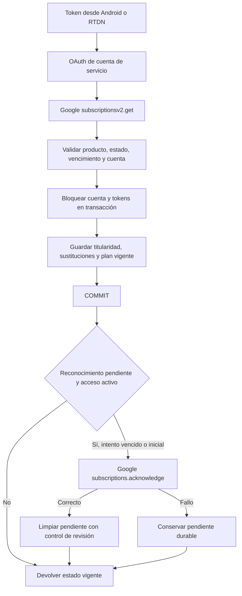

# Google Play: pagos, suscripciones y operación del backend

Revisión: 2026-10-23. El código es la fuente de verdad. Este documento registra implementación y evidencia local, sin certificar el despliegue.

[README](../README.md) | [Contrato API](api-reference.md#suscripciones-google-play) | [Configuración](runtime-and-configuration.md#operación-de-suscripciones-google-play) | [Verificación del modelo de plan único](features/play_billing_reliability/verification.md) | [Flujo Android completo](../../MiraiLink/docs/estudio/flujos/suscripciones.md)

El último enlace requiere ambos repositorios como hermanos; en otro checkout consultar `docs/estudio/flujos/suscripciones.md` de MiraiLink.

## 1. Reparto de responsabilidades

Google Play cobra y conserva el estado de la suscripción. Android presenta el catálogo, abre la pasarela y entrega el token. El backend verifica con Google, vincula a la cuenta MiraiLink, concede derechos, persiste y reconoce. No se usan credenciales de servicio en Android.

La autenticación de la cuenta Google compradora, la autenticación de usuario MiraiLink y la autorización de la cuenta de servicio del servidor son tres controles distintos. Ser license tester no concede permisos al backend.

Package fijo: `com.feryaeljustice.mirailink`. Productos admitidos: `mirailink_plus`, `mirailink_premium`. Identificadores de planes y selección estricta: guía Android.

## 2. Endpoints y contrato

Prefijo `/api/subscription`, montado por la aplicación Express.

| Método/ruta | Control | Comportamiento |
| --- | --- | --- |
| GET /status | authenticateToken | Leer user_subscriptions y proyectar derechos |
| POST /verify | authenticateToken y Zod | Verificar token con Google, guardar y reconocer si procede |
| POST /cancel-intent | authenticateToken y Zod | Registrar intención y devolver URL de gestión |
| POST /google-play-notifications | OIDC de Google validado en el servicio | Recibir RTDN y verificar de nuevo la compra |

`/verify` acepta purchaseToken y productId no vacíos; basePlanId tiene valor por defecto monthly-autorenew; orderId es opcional. El controlador pasa a verifyAndSavePurchase solamente usuario autenticado, token y producto. Plan, pedido, renovación y vencimiento definitivos vienen de Google. No se concede un plan fiándose del body.

El DTO público incluye isPremium, isPlus, plan, status, productId, basePlanId, expiresAt, autoRenewing, providerState, hasAccess y acknowledgementPending. GET status y POST verify fijan X-Subscription-Plan. No se devuelven tokens, secretos ni filas SQL completas. Premium también devuelve isPlus=true.

Status consulta la base, no Google. Una fila puede permanecer desactualizada hasta RTDN/reconciliación, aunque la proyección comprueba vencimiento en cada respuesta.

## 3. Verificación, transacción y reconocimiento



El servicio adquiere el bloqueo de cuenta antes de consultar Google dentro de la transacción; después valida/bloquea los tokens. El diagrama resume las dependencias funcionales, no cada sentencia SQL.

1. accessToken lee el archivo de cuenta de servicio indicado por configuración y firma un JWT RS256 para el scope androidpublisher. Intercambia por OAuth y reutiliza el token hasta cerca de su expiración.
2. subscriptionsv2.get obtiene la compra real. Timeout de peticiones: 15 segundos.
3. parsePlayPurchase elige el line item soportado con mayor vencimiento y comprueba producto esperado. La ausencia de expiración solo se tolera en estados pendientes.
4. Los bloqueos advisory de PostgreSQL serializan cuenta y tokens. Un token no puede asignarse a otra cuenta. El hash ofuscado de Google debe coincidir con SHA-256 del ID MiraiLink. Para tokens nuevos no se acepta ausencia de asociación.
5. linkedPurchaseToken y superseded_by impiden restaurar compras antiguas que ya fueron sustituidas. Una compra independiente no reemplaza silenciosamente otra suscripción verificada vigente. Una sustitución pendiente no elimina derechos de la anterior.
6. Se actualiza una sola fila de user_subscriptions por usuario y la titularidad histórica de tokens. Se confirma la transacción antes del reconocimiento.
7. Si Google devuelve ACKNOWLEDGEMENT_STATE_PENDING y hay acceso activo, se intenta reconocer cuando corresponde según la fecha del intento persistido.
8. La llamada de reconocimiento acepta cuerpo vacío, incluido HTTP 200/204. Un fallo no deshace el registro verificado: conserva pendiente, contador y próxima fecha.
9. La limpieza posterior usa token y revision para no pisar una actualización concurrente. La respuesta refleja el plan vigente del usuario.

Conceder acceso tras verificar y antes de reconocer es el orden implementado. `acknowledgementPending=true` no significa pago pendiente ni implica por sí solo acceso denegado.

## 4. Estados y derechos

| Estado Google | Acceso implementado |
| --- | --- |
| ACTIVE | Sí si el vencimiento está en el futuro |
| IN_GRACE_PERIOD | Sí mientras el vencimiento consultado sea futuro |
| CANCELED | Sí hasta terminar el período pagado |
| PENDING / PENDING_PURCHASE_CANCELED | No |
| ON_HOLD / PAUSED / EXPIRED / otros | No |

El DTO exige provider_verified=true, status activo, producto admitido y expiración futura. Una fila existente sin derechos se proyecta como expired; una cuenta sin fila, como free. providerState conserva el estado Google separado de los derechos.

El reconocimiento inicial debe respetar el plazo de Google; el plazo ordinario de tres días empieza al pasar a PURCHASED. Las renovaciones automáticas no requieren otro reconocimiento inicial. Consultar las reglas específicas si se incorporan planes prepago, que no forman parte de los planes autorrenovables descritos.

cancel-intent solo actualiza cancellation_intent_at. No modifica auto_renewing. El usuario termina la gestión en Google Play.

## 5. Persistencia y reintentos

| Elemento | Uso |
| --- | --- |
| user_subscriptions | Una fila de plan vigente por usuario |
| play_purchase_owners | Titularidad de tokens y superseded_by |
| provider_verified / provider_state / last_verified_at | Resultado y momento de verificación |
| expires_at / auto_renewing | Estado de Google |
| acknowledgement_pending / attempts / next_attempt_at / error_code | Reconocimiento durable y sus reintentos |
| verification_next_attempt_at | Próxima reconciliación |
| revision | Protección ante actualizaciones concurrentes |
| cancellation_intent_at | Intención local de cancelación |

Los nombres completos de las cuatro columnas de reconocimiento empiezan por `acknowledgement_`.

La migración existente `021_subscription_confirmation.sql` amplía user_subscriptions e índices con IF NOT EXISTS. También se requieren las migraciones previas de suscripciones/titularidad y la incorporación de superseded_by. Usar el ejecutor de migraciones del proyecto y sus instrucciones; no ejecutar SQL contra producción sin revisar estado y respaldo. Esta sesión no creó una nueva migración ni aplicó migraciones a la base del usuario.

`reconcileSubscriptions` reserva hasta 50 registros para reconocimientos vencidos y hasta 50 para verificación ordinaria. Excluye tokens sustituidos. La programación persistida de reconocimiento usa esperas de 1, 2, 4 y hasta 6 horas. La selección requiere que hayan vencido tanto la fecha de reconocimiento como la de verificación. No es una garantía de ejecución exacta a esas horas: depende del worker, volumen y disponibilidad.

INVALID_PURCHASE expira la fila y programa revisión posterior; los errores transitorios posponen la verificación una hora. Se conservan los bloqueos y una verificación concurrente exitosa tiene prioridad.

Worker: `node --env-file=.env scripts/affinity-worker.js billing`. El temporizador documentado está en deploy/systemd/mirailink-affinity-billing.timer y activa mirailink-affinity@billing.service cada hora, con arranque diferido de dos minutos. Inspeccionar la unidad instalada: tener los archivos en Git no demuestra que esté habilitada. Persistent=true por sí solo no acredita recuperación de todas las ejecuciones perdidas de un temporizador monotónico.

## 6. RTDN y tokens que todavía no conoce el servidor

Se valida JWT OIDC de Pub/Sub: RS256, firma con claves Google, issuer, audience, email esperado y email_verified=true. Se comprueba el package del mensaje. No se confía en el tipo de notificación para conceder derechos: se consulta Google.

Si el token ya tiene dueño, se verifica con esa cuenta. Si es desconocido:
1. Consultar subscriptionsv2.get con OAuth del servidor.
2. Tomar únicamente obfuscatedExternalAccountId devuelto por Google.
3. Exigir un SHA-256 hexadecimal válido y buscar un usuario no eliminado cuyo UUID produzca ese hash.
4. Ejecutar verifyAndSavePurchase con todas sus comprobaciones. Esta ruta hace una segunda consulta a Google para reutilizar la verificación habitual.
5. Devolver 204 cuando se ha procesado. Si no hay asociación segura o Google falla, devolver error; los códigos no exitosos permiten reentregas según la configuración de Pub/Sub.

Esto permite recuperar una compra aunque Android se cierre antes de enviar su token. No inventa asociaciones para compras antiguas sin identificador ofuscado. Una asociación imposible no queda arreglada por repetir indefinidamente: requiere diagnóstico y supervisión de entregas.

## 7. Configuración y comprobaciones operativas

| Variable | Función |
| --- | --- |
| GOOGLE_PLAY_SERVICE_ACCOUNT_FILE | Archivo de credenciales del servidor, nunca del APK |
| GOOGLE_PLAY_RTDN_AUDIENCE | Audience esperado del JWT push |
| GOOGLE_PLAY_RTDN_EMAIL | Identidad Google esperada para ese push |

Configurar Google Play Android Developer API y la cuenta de servicio con acceso a MiraiLink y permisos financieros y de gestión de pedidos/suscripciones. Configurar por separado el topic/subscription de Pub/Sub, publicación de Google y push autenticado accesible. Los parámetros RTDN son identidad de infraestructura, no el correo del comprador.

En el entorno local inspeccionado el 2026-10-23, el archivo de cuenta de servicio estaba configurado y existía; las dos variables RTDN no estaban definidas en el .env revisado. Esto no prueba el entorno de otro proceso o despliegue. Sin ellas la entrada RTDN devuelve PLAY_NOT_CONFIGURED.

No registrar ni copiar credenciales, Authorization, purchaseToken, pedidos ni datos personales en incidencias. Para diagnóstico publicar solo fase, HTTP, código sanitizado y si las identidades coinciden.

## 8. Errores y caso real observado

| Código | Interpretación implementada |
| --- | --- |
| PLAY_NOT_CONFIGURED | Falta configuración necesaria |
| PLAY_UNAVAILABLE | Timeout/red, JSON inválido o HTTP Google distinto de 400/404 |
| INVALID_PURCHASE | Compra inconsistente o Google devuelve 400/404 |
| PURCHASE_ALREADY_BOUND | Token vinculado a otra cuenta |
| PURCHASE_ACCOUNT_MISMATCH | Cuenta ofuscada ausente, distinta o imposible de resolver |
| PURCHASE_REPLACEMENT_REQUIRED | Intento de sustituir indebidamente un plan vigente |
| PLAY_ACKNOWLEDGEMENT_PENDING | Error persistido de reconocimiento; puede coexistir con acceso |

Google 401/403 se convierte actualmente en 503 PLAY_UNAVAILABLE. Por eso ese mensaje no demuestra caída de Google. Android agrupa varios códigos de compra bajo AffinityError.PLAY y el mismo aviso genérico.

En esta sesión se observó:
- Productos y una compra existente consultables desde Android.
- Rechazo de cambio de plan: Please ensure the old subscription is acked before starting plan change.
- POST verify al backend local: 503 PLAY_UNAVAILABLE.
- Consulta directa de solo lectura con las credenciales locales: OAuth 200 y compra 401 permissionDenied.
- La cuenta del archivo coincide con la captura aportada y consulta el catálogo con 200.
- La captura muestra permisos financieros y de gestión de pedidos activados.

**Causa final pendiente.** El rechazo de autorización es real, pero no se ha demostrado que falten esos permisos visibles. Propagación es una posibilidad, no un diagnóstico confirmado. Google documenta hasta 48 horas para propagación de cambios de permisos de cuenta. No se debe eliminar/recrear claves, ampliar permisos indiscriminadamente ni reconocer desde Android para ocultar el fallo de verificación.

Procedimiento: confirmar entorno/destino y cuenta efectiva, fecha y alcance de permisos guardados, repetir consulta de compra con OAuth fresco y errores sanitizados, resolver el rechazo, restaurar y comprobar reconocimiento. Si la compra de prueba ya venció o se reembolsó, validar el siguiente ciclo con una compra de prueba nueva. No desactivar verificación por tratarse de debug.

## 9. Cambios y pruebas de esta sesión

Cambios de servidor atribuibles a estas correcciones:
- src/services/play-billing.js: recuperar tokens RTDN desconocidos a partir del identificador auténtico de Google; reutilizar verificación y devolver error ante asociación imposible.
- tests/unit/services/play-billing.test.js: cuatro escenarios de token desconocido: asociación válida, identificador ausente, cuenta desconocida y Google no disponible.
- docs/api-reference.md y esta guía: comportamiento y diagnóstico.

La transacción, plan único, restricciones de titularidad/sustitución, reconocimiento después del commit, reintentos, DTO, rutas y migración 021 ya estaban en el árbol local al empezar. Su descripción aquí no atribuye su autoría a esta sesión. Las correcciones Android están detalladas en la guía enlazada.

Evidencia obtenida durante la sesión:
- 48 pruebas backend seleccionadas correctas, con Google/base simulados.
- ESLint en los dos archivos JavaScript modificados y comprobación sintáctica correctos.
- Contrato OpenAPI: 77 operaciones.
- 27 pruebas Android seleccionadas correctas y assembleDebug correcto.
- Lint Android bloqueado por conflictos de dependencias instrumentadas.
- Lecturas reales de OAuth, catálogo y consulta de compra, con los resultados anteriores. No se ejecutaron reconocimientos, reembolsos ni cambios de permisos en esas consultas.

Las verificaciones PostgreSQL y fallos preexistentes de la suite completa descritos en [el informe de fiabilidad](features/play_billing_reliability/verification.md) pertenecen a ese trabajo separado. No se han repetido ni sustituido con estas pruebas seleccionadas. Tampoco se verificaron aquí el despliegue del worker ni RTDN real.

Comandos reproducibles desde este repositorio:

```powershell
node node_modules/vitest/vitest.mjs run tests/unit/services/play-billing.test.js tests/unit/controllers/subscription.controller.test.js tests/unit/validation/subscription.schemas.test.js tests/integration/subscription.routes.test.js
node node_modules/eslint/bin/eslint.js src/services/play-billing.js tests/unit/services/play-billing.test.js
node --check src/services/play-billing.js
node scripts/check-openapi-routes.js
```

Para la prueba real de aceptación: comprobar token legítimo, cuenta correcta, almacenamiento duradero, acceso esperado y reconocimiento confirmado; repetir con interrupción tras pagar, notificación anterior al envío Android, error temporal, sustitución, cancelación y expiración. Usar cuentas de prueba y una base desechable para pruebas que escriban datos.

## 10. Fuentes del código y documentación oficial

- [Servicio](../src/services/play-billing.js), [controlador](../src/controllers/subscription.controller.js), [rutas](../src/routes/subscription.routes.js), [DTO](../src/dto/subscription.dto.js), [validación](../src/validation/subscription.schemas.js).
- [Migración 021](../src/database/migrations/021_subscription_confirmation.sql), [worker](../scripts/affinity-worker.js), [timer](../deploy/systemd/mirailink-affinity-billing.timer).
- [Integración Billing](https://developer.android.com/google/play/billing/integrate), [ciclo de suscripciones](https://developer.android.com/google/play/billing/lifecycle/subscriptions), [pruebas](https://developer.android.com/google/play/billing/test).
- [Permisos de la cuenta de servicio](https://developers.google.com/android-publisher/getting_started), [propagación de permisos](https://developers.google.com/android-publisher/api-ref/rest/v3/users#DeveloperLevelPermission).
